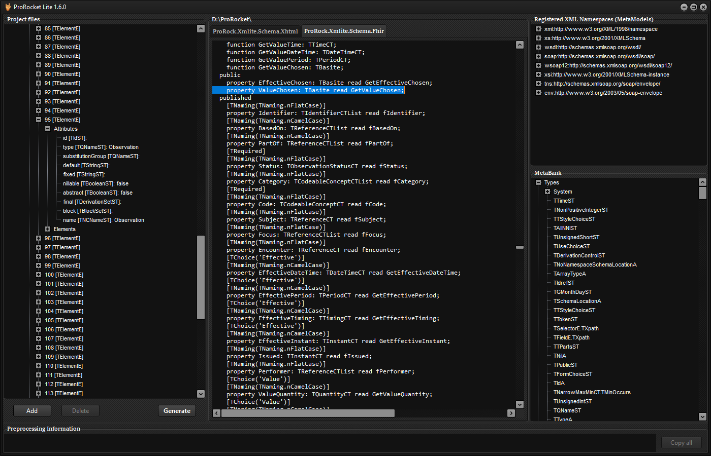

# GUI

`ProRocket.Lite.exe`, from the [zip](prorocket-lite/index.md).

1. Add the schema files: the main XSD or WSDL and the files it imports and includes.
2. Click **Generate**.

The project tree shows each file as ProRock reads it, parsed through ProRock's own XML Schema and WSDL classes. Generate fills the
code preview with one tab per unit and writes the units into the folder named above it.

All of FHIR R4 above: 146 resource types in one unit of about 46,000 lines, and no problems reported.

## When something is missing

The messages panel lists the problems found in the schema set: a missing imported schema or include, a name that resolves to
nothing. Hover a line for what it means and what to do, in plain words. **Copy all** copies the list.

The same problems reach scripts as machine-readable lines: [Command line](cli.md#problem-lines).
