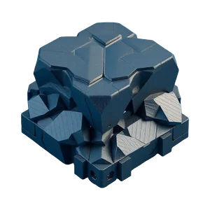

# ProRock { .hero-hidden }

ProRock 🤟

Your schema in. Ready Delphi classes out.

A free generator for XSD and WSDL, and an open-source library that reads and writes XML and calls SOAP services through the classes it makes.

<a href="basite/" title="The core (Basite)">Basite</a><a href="xmlite/" title="XML (Xmlite)">Xmlite</a><a href="soapite/" title="SOAP (Soapite)">Soapite</a>

<a class="md-button md-button--primary" href="getting-started/">Get started in 5 minutes</a><a class="md-button" href="how-it-works/">How it works</a>

<a class="claim" href="prorocket-lite/"><svg width="24" height="24" xmlns="http://www.w3.org/2000/svg" fill="none" stroke="currentColor" stroke-linecap="round" stroke-linejoin="round" stroke-width="2" class="lucide lucide-rocket" viewBox="0 0 24 24"><path d="M12 15v5s3.03-.55 4-2c1.08-1.62 0-5 0-5M4.5 16.5c-1.5 1.26-2 5-2 5s3.74-.5 5-2c.71-.84.7-2.13-.09-2.91a2.18 2.18 0 0 0-2.91-.09"/><path d="M9 12a22 22 0 0 1 2-3.95A12.88 12.88 0 0 1 22 2c0 2.72-.78 7.5-6 11a22.4 22.4 0 0 1-4 2z"/><path d="M9 12H4s.55-3.03 2-4c1.62-1.08 5 .05 5 .05"/></svg><b>Free generator</b>GUI and command line, free for any use, commercial too. The generated code is yours.</a><a class="claim" href="tested-schemas/"><svg width="24" height="24" xmlns="http://www.w3.org/2000/svg" fill="none" stroke="currentColor" stroke-linecap="round" stroke-linejoin="round" stroke-width="2" class="lucide lucide-badge-check" viewBox="0 0 24 24"><path d="M3.85 8.62a4 4 0 0 1 4.78-4.77 4 4 0 0 1 6.74 0 4 4 0 0 1 4.78 4.78 4 4 0 0 1 0 6.74 4 4 0 0 1-4.77 4.78 4 4 0 0 1-6.75 0 4 4 0 0 1-4.78-4.77 4 4 0 0 1 0-6.76"/><path d="m16 9-5.5 5.5L8 12"/></svg><b>Proven on real schemas</b>HL7 FHIR R4, e-invoices, Excel workbooks, ISO 20022, SOAP services.</a><a class="claim" href="samples/#excel-workbook"><svg width="24" height="24" xmlns="http://www.w3.org/2000/svg" fill="none" stroke="currentColor" stroke-linecap="round" stroke-linejoin="round" stroke-width="2" class="lucide lucide-repeat" viewBox="0 0 24 24"><path d="m17 2 4 4-4 4"/><path d="M3 11v-1a4 4 0 0 1 4-4h14M7 22l-4-4 4-4"/><path d="M21 13v1a4 4 0 0 1-4 4H3"/></svg><b>Writes back what it read</b>Even what the schema does not describe. Excel opens the file and recalculates.</a><a class="claim" href="how-it-works/"><svg width="24" height="24" xmlns="http://www.w3.org/2000/svg" fill="none" stroke="currentColor" stroke-linecap="round" stroke-linejoin="round" stroke-width="2" class="lucide lucide-braces" viewBox="0 0 24 24"><path d="M8 3H7a2 2 0 0 0-2 2v5a2 2 0 0 1-2 2 2 2 0 0 1 2 2v5c0 1.1.9 2 2 2h1M16 21h1a2 2 0 0 0 2-2v-5c0-1.1.9-2 2-2a2 2 0 0 1-2-2V5a2 2 0 0 0-2-2h-1"/></svg><b>No DOM, no XPath</b>The classes are the schema, and code completion is their documentation.</a><a class="claim" href="large-documents/"><svg width="24" height="24" xmlns="http://www.w3.org/2000/svg" fill="none" stroke="currentColor" stroke-linecap="round" stroke-linejoin="round" stroke-width="2" class="lucide lucide-zap" viewBox="0 0 24 24"><path d="M15.914 4a1.5 1.5 0 0 0-2.474-1.561l-9 9A1.5 1.5 0 0 0 5.5 14h4.002a.5.5 0 0 1 .471.666L8.086 20a1.5 1.5 0 0 0 2.475 1.56l9-9A1.5 1.5 0 0 0 18.5 10h-3.997a.5.5 0 0 1-.472-.667z"/></svg><b>Fast</b>Lazy objects: an e-invoice reads in under a millisecond, 1,000 FHIR patients in 0.1 s.</a><a class="claim" href="getting-started/"><svg width="24" height="24" xmlns="http://www.w3.org/2000/svg" fill="none" stroke="currentColor" stroke-linecap="round" stroke-linejoin="round" stroke-width="2" class="lucide lucide-package-open" viewBox="0 0 24 24"><path d="M12 22v-9M15.17 2.21a1.67 1.67 0 0 1 1.63 0L21 4.57a1.93 1.93 0 0 1 0 3.36L8.82 14.79a1.66 1.66 0 0 1-1.64 0L3 12.43a1.93 1.93 0 0 1 0-3.36z"/><path d="M20 13v3.87a2.06 2.06 0 0 1-1.11 1.83l-6 3.08a1.93 1.93 0 0 1-1.78 0l-6-3.08A2.06 2.06 0 0 1 4 16.87V13"/><path d="M21 12.43a1.93 1.93 0 0 0 0-3.36L8.83 2.2a1.64 1.64 0 0 0-1.63 0L3 4.57a1.93 1.93 0 0 0 0 3.36l12.18 6.86a1.64 1.64 0 0 0 1.63 0z"/></svg><b>Nothing to install</b>Pure Delphi source, Apache 2.0. Delphi 10.3 to 13, Win64 and Win32.</a>

<h2 id="it-is-young">It is young, and it grows with you</h2>
<a class="md-button md-button--primary" href="https://github.com/VitalyPopov/ProRock">⭐ Star on GitHub</a><a class="md-button" href="https://github.com/VitalyPopov/ProRock/issues/new/choose">Open an issue</a><a class="md-button ask-support" href="https://github.com/sponsors/VitalyPopov">Support the project</a>

One developer builds it, and real use is what moves it forward. Try it on your schema and tell what breaks: that is the most
useful thing you can do. And if it helps you, a star costs nothing and helps other Delphi developers find it.
