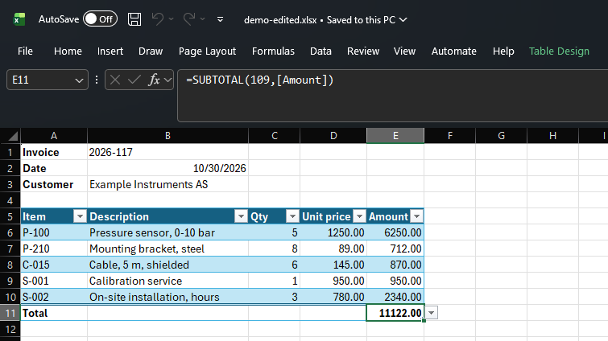

# ProRock

**Schema-typed XML for Delphi.** Generate exact Delphi classes from XSD and WSDL, parse and write XML through them, call SOAP
services with them.

> **When the schema changes, regenerate, don't re-patch.**

A schema changes: a new e-invoicing version, an ISO 20022 release, a service adding fields. Hand-written or hand-patched mappings
then have to be found and fixed one by one. With ProRock you regenerate the units, and the compiler shows exactly what changed.

[Get started in 5 minutes](getting-started.md){ .md-button .md-button--primary }
[{ .button-icon } Download ProRocket Lite](https://github.com/VitalyPopov/ProRock/releases/latest/download/ProRocket-Lite.zip){ .md-button }

## Proven on real schemas

- **HL7® FHIR® R4** - all 146 resource types from the official schemas: a Bundle of 1,000 Patients read in 0.1 s,
  narratives written back as they were ([sample](samples.md#fhir-resources))
- **Excel workbooks** - SpreadsheetML from ECMA-376: an invoice read, edited and written back with everything Excel put in
  it; Excel opens it and recalculates ([sample](samples.md#excel-workbook))
- **SOAP services** - the EU VIES VAT service, WS-Security, client certificates ([getting started](getting-started.md))

What of XML and XML Schema is covered, in part or not yet: [XML support](xml-support.md).

## What it looks like

A FHIR Bundle: each entry holds one of 146 resource types, an Observation's value one of eleven - the classes say which:

```pascal
bundle.FromXml(xml);
for var entry in bundle.Entry do
begin
  var resource := entry.Resource.Chosen;               // the one resource in this entry
  if resource is TObservationCT then
  begin
    var value := TObservationCT(resource).ValueChosen; // TQuantityCT, TCodeableConceptCT, TStringCT... or nil
    if value is TQuantityCT then
      Writeln(TQuantityCT(value).Value.Value, ' ', TQuantityCT(value).&Unit.Value); // 185 lbs
  end;
end;
```

An Excel cell changed, and the workbook written back with everything else as it was:

```pascal
cell.V := '5';                           // <c r="C6"><v>5</v></c>
workbook.CalcPr.FullCalcOnLoad := True;  // Excel recalculates the totals when it opens the file
```



A SOAP call from a WSDL takes [5 minutes](getting-started.md).

## Two parts

**ProRock** - the runtime library. Open source (Apache 2.0), pure Delphi source, no dependencies beyond the RTL, no packages
to install.

- [Basite](xmlite.md#under-the-hood): the core - plain Delphi objects described once by their metadata (MetaBank): nested
  objects created and freed with their parent, presence of every value. Independent of any data format, the base for Xmlite
  and later Jsonite
- [Xmlite](xmlite.md): XML parsing and serialization to and from plain Delphi objects, namespace- and schema-aware. Parsing works
  in place on the text, without building a DOM. What of XML it covers: [XML support](xml-support.md)
- [Soapite](soapite.md): SOAP 1.1 / 1.2 clients on top of Xmlite, generated from WSDL, with typed requests, responses and faults

**ProRocket Lite** - the code generator: XSD and WSDL in, Delphi units out, in a [GUI](prorocket-lite.md) and from the
[command line](cli.md) - friendly to scripts and AI coding assistants. Free for any use, including commercial; the generated
code is yours.

## How it is designed

A cockpit, not an engine room: the complexity stays inside, outside are plain Delphi objects you own. Little to learn,
nothing to install, as fast as it can be made - and tolerant of real-world data. More in
[Design principles](principles.md).

## Platforms

Delphi 10.3 Rio to 13 Florence, Win64 and Win32. All units compile for Android 32/64-bit (Delphi 13); running on a device is
not verified yet. Details: [Limitations and notes](limitations.md#platform-and-compatibility).

## Feedback

Feedback, real-world schemas that do not work yet, and contributions are welcome:
[open an issue](https://github.com/VitalyPopov/ProRock/issues/new/choose) or see
[CONTRIBUTING.md](https://github.com/VitalyPopov/ProRock/blob/main/CONTRIBUTING.md).

If ProRock is useful to you, at least smash the ⭐ [Star on GitHub](https://github.com/VitalyPopov/ProRock) - it costs nothing
and helps other Delphi developers find it. And if you'd like to do more, you can
[support the project](https://github.com/sponsors/VitalyPopov). Thank you! 🤟

Since October 2026, development is assisted by [Claude Code](https://claude.com/claude-code) (Anthropic): it helps with
implementation, tests and generator fixes. Design, decisions and verification remain the author's.
