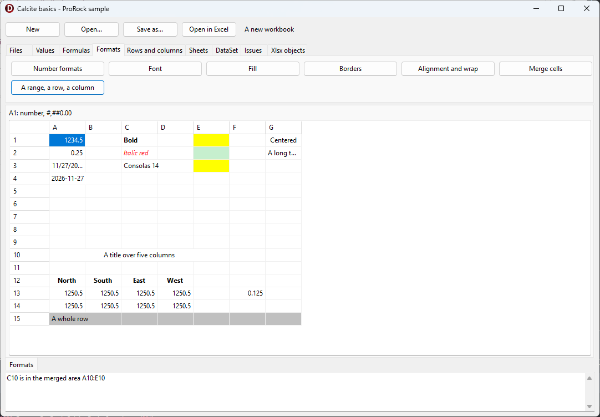
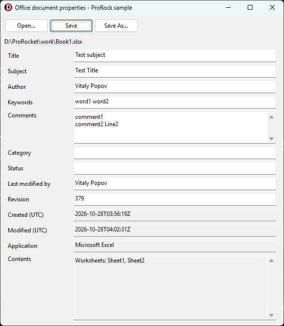

# Samples

In [`Samples`](https://github.com/VitalyPopov/ProRock/tree/main/Samples) of the repository, one group project
(`ProRock.Samples.groupproj`). The generated units are included, so the samples build without running the generator. The
schemas and WSDLs they come from are not: each sample's README says where to get them and the command that generates its
units again.

!!! tip "Your own schemas need the generator"
    It is a free download: [ProRocket Lite](prorocket-lite/index.md).

| Sample | What it shows |
|---|---|
| [`ProRock.Calcite.Basics`](#excel-workbook) | Excel workbooks with Calcite, no generator and no Excel: values, formulas, formats, rows and columns, sheets, a DataSet export, open-edit-save - a button for each, its handler the code to copy |
| [`ProRock.Xmlite.EInvoice`](#electronic-invoices) | an electronic invoice under EN 16931 from the official schemas (about 51,000 generated lines): the same window for CII (ZUGFeRD, Factur-X, XRechnung) and UBL (Peppol, XRechnung), written back as it was read |
| [`ProRock.Xmlite.Fhir`](#fhir-resources) | HL7® FHIR® R4 resources from the official schemas (about 49,000 generated lines): a Bundle listed with each Observation's value, the narrative as text, written back as it was; a Bundle of 1,000 resources timed |
| [`ProRock.Xmlite.DocumentProperties`](#office-document-properties) | the properties of any Office document: open, edit, save; the sheet or slide titles |
| [`ProRock.Soapite.CheckVatService`](https://github.com/VitalyPopov/ProRock/tree/main/Samples/ProRock.Soapite.CheckVatService) | EU VIES VAT number validation through the generated `TCheckVatService`, with live SOAP Fault handling; `-name:` compares the trader's name too (`checkVatApprox`) and tells an absent match code from VALID with `Present` |
| [`ProRock.Soapite.WsSecurity`](https://github.com/VitalyPopov/ProRock/tree/main/Samples/ProRock.Soapite.WsSecurity) | a WS-Security UsernameToken (PasswordDigest, Nonce, Timestamp) in the SOAP header, from units generated from the OASIS schemas; offline, or `-live`. Other header blocks work the same way, e.g. the ebMS 3.0 `eb:Messaging` of AS4 |
| [`ProRock.Http.ClientCertificate`](https://github.com/VitalyPopov/ProRock/tree/main/Samples/ProRock.Http.ClientCertificate) | client certificates (mutual TLS) against the public test server client.badssl.com: HTTP 400 without, 200 with - from a file and from memory |
| [`ProRock.Soapite.Calculator`](https://github.com/VitalyPopov/ProRock/tree/main/Samples/ProRock.Soapite.Calculator) | a generated client calling a public calculator service (`-soap12` and `-xml` switches) |
| [`ProRock.Xmlite.Namespaces`](https://github.com/VitalyPopov/ProRock/tree/main/Samples/ProRock.Xmlite.Namespaces) | a generated metamodel from `order.xsd`: parsing, enums, serialization, round trip |
| [`ProRock.Xmlite.Basic`](https://github.com/VitalyPopov/ProRock/tree/main/Samples/ProRock.Xmlite.Basic) | hand-written models, basic parsing and serialization |

## Excel workbook

[`ProRock.Calcite.Basics`](https://github.com/VitalyPopov/ProRock/tree/main/Samples/ProRock.Calcite.Basics) shows
[Calcite](calcite.md), the Excel library: a tab for each feature - files, values, formulas, formats, rows and columns, sheets, a
DataSet, open and edit, issues, the workbook's own objects - and a button for each thing it does. Each button writes its
sheet of one workbook; the grid shows the sheet as Calcite reads it back, the line above it the selected cell's formula,
number format and value type. Open in Excel shows a copy in Excel, Save as writes the workbook. Each handler is short and
starts from the sheet: it is the code to copy, and the [Calcite page](calcite.md) shows it word for word.



```pascal
// the Write formulas button
var sheet := FeatureSheet('Formulas');
sheet['A1'].Value := 10;
sheet['A2'].Value := 20;
sheet['A3'].Value := 30;
sheet['A4'].Formula := '=SUM(A1:A3)';
sheet['B1'].Formula := '=A1*2';
// English names and commas, as Excel's Formula
sheet['C1'].Formula := '=IF(A4>50,"big","small")';
```

The sample writes `Calcite sample.xlsx` and `Prices.xlsx` next to the program.

## Electronic invoices

[`ProRock.Xmlite.EInvoice`](https://github.com/VitalyPopov/ProRock/tree/main/Samples/ProRock.Xmlite.EInvoice) opens an invoice or credit
note under the European standard EN 16931, which has two syntaxes: UN/CEFACT CII, the XML of ZUGFeRD, Factur-X and one form of XRechnung, and
OASIS UBL, the XML of Peppol and the other form of XRechnung. Both go into units ProRocket generates from the official schemas (`Schemas`
in the sample's folder: CII D16B, about 9,000 lines; UBL 2.4, about 42,000 lines), and the root element says which. The window shows the seller and the
buyer, the lines, the VAT and the totals; Save as writes the file back. `invoice-cii.xml` and `invoice-ubl.xml` are one invoice from KoSIT's
XRechnung test suite, and show the same in both. Its seller and buyer are placeholders of the test suite.

All that differs between the syntaxes is where a field is, so that is all `InvoiceCii.pas` and `InvoiceUbl.pas` hold:

```pascal
// CII: rsm:CrossIndustryInvoice
var settlement := aRoot.SupplyChainTradeTransaction.ApplicableHeaderTradeSettlement;
aInvoice.Currency := settlement.InvoiceCurrencyCode.XmlValue;
aInvoice.GrandTotal := First(settlement.SpecifiedTradeSettlementHeaderMonetarySummation.GrandTotalAmount);

// UBL: Invoice
aInvoice.Currency := aRoot.DocumentCurrencyCode.XmlValue;
aInvoice.GrandTotal := aRoot.LegalMonetaryTotal.TaxInclusiveAmount.XmlValue;
```

The sample reads XML: a ZUGFeRD or Factur-X file holds its XML inside a PDF, and taking it out is not part of the sample. Reading is not checking:
the rules of EN 16931 and XRechnung (Schematron) are not run, and the totals are not added up. Amounts are `Double`, exact up to 15
significant digits.

## FHIR resources

[`ProRock.Xmlite.Fhir`](https://github.com/VitalyPopov/ProRock/tree/main/Samples/ProRock.Xmlite.Fhir) reads HL7® FHIR® R4
XML - a Bundle or a single resource - into the units ProRocket generates from the standard's schemas (`fhir-single.xsd`,
`fhir-xhtml.xsd`): 146 resource types, their data types and the narrative's XHTML, about 49,000 lines. It lists each resource
with what it is, its value and when; the selected one's narrative is shown as text. Save as writes the file back as it
was read, and Speed test reads and writes a Bundle of 1,000 resources made of the same entries. `bundle.xml` holds the
Patient and Observation examples of the specification.


The resource of a Bundle entry is a choice of all 146 resource types; an Observation's `value[x]` is one of eleven.
Only the member in the document is created, and the typed shortcut gives it:

```pascal
for var entry in bundle.Entry do
begin
  var resource := entry.Resource.Chosen;               // the one resource in this entry
  if (resource <> nil) and resource.InheritsFrom(TObservationCT) then
  begin
    var value := TObservationCT(resource).ValueChosen; // TQuantityCT, TCodeableConceptCT, TStringCT... or nil
    if (value <> nil) and value.InheritsFrom(TQuantityCT) then
      Writeln(TQuantityCT(value).Value.Value, ' ', TQuantityCT(value).&Unit.Value); // 185 lbs
  end;
end;
```

The narrative is XHTML mixed content: `InnerText` gives its text; the sample walks `XmlContent` to end a line after
each paragraph. FHIR's own `meta` element is `Meta_` in every resource class: `Meta` is the class metadata.

Compiling the FHIR unit takes 10-20 seconds on Delphi 13; the program starts in about a third of a second.

## Office document properties

[`ProRock.Xmlite.DocumentProperties`](https://github.com/VitalyPopov/ProRock/tree/main/Samples/ProRock.Xmlite.DocumentProperties)
opens any Office document (.docx, .xlsx, .pptx) and edits the properties Office shows in **File > Info**: title, subject,
author, keywords, description, category, status. Save writes them back; Excel opens the saved file without a repair prompt
and shows every value in File > Info.



An Office document is a zip of XML parts (OPC, ECMA-376 Part 2). The sample opens it with `TPackageOoxml` from
`ProRock.Office.Ooxml`: a part is read on first use, and a part not changed is saved as the same bytes, in the same order and
with the same compression. `Properties` are the core properties (`docProps/core.xml`) as plain values - text, and dates in
UTC; an empty value removes the element, as Office does:

```pascal
var properties: TCoreProperties := fDocument.Properties;
TitleEdit.Text := properties.Title;
...
if TitleEdit.Text <> properties.Title then // only what changed
  properties.Title := TitleEdit.Text;
```

Save sets `Modified` when anything changed, as Office does; a save with nothing changed leaves the file as it was. A
digitally signed document (`Signed`) gets a warning first: the signature usually covers the core properties, so saving
breaks it.

What the application says about the document (`docProps/app.xml`) - its name, and the titles of its parts: the sheets of a
workbook, the slides of a presentation - is read into the classes generated from the official schema
(`shared-documentPropertiesExtended.xsd`, ECMA-376 Part 4; the unit ships in `Source`). The part is found through the
package's relationships, and `Part<T>` reads it:

```pascal
for var relationship: TRelationshipOoxml in fDocument.Relationships('', '/extended-properties') do
  if not relationship.Part.IsEmpty then
    extended := fDocument.Part<TPropertiesE>(relationship.Part);
```

It is shown, not edited (saved as it was). The titles of the parts are a list of plain strings - a `vt:vector` of
`vt:lpstr` - grouped by heading pairs, a name and a count each:

```xml
<HeadingPairs><vt:vector size="2" baseType="variant">
  <vt:variant><vt:lpstr>Worksheets</vt:lpstr></vt:variant><vt:variant><vt:i4>2</vt:i4></vt:variant>
</vt:vector></HeadingPairs>
<TitlesOfParts><vt:vector size="2" baseType="lpstr">
  <vt:lpstr>Sales</vt:lpstr><vt:lpstr>Costs</vt:lpstr>
</vt:vector></TitlesOfParts>
```

```pascal
var titles := extended.TitlesOfParts.Vector.Lpstr;     // a TList<string>: Sales, Costs
var pairs := extended.HeadingPairs.Vector.Variant;     // Worksheets, 2
for var i := 0 to pairs.Count div 2 - 1 do
begin
  var count: integer := pairs[2 * i + 1].I4;
  ...                                                  // "Worksheets: Sales, Costs"
end;
```

The schemas behind it use substitution groups and `xsi:type` - see [XML concepts](xml-concepts.md) for what they are.
