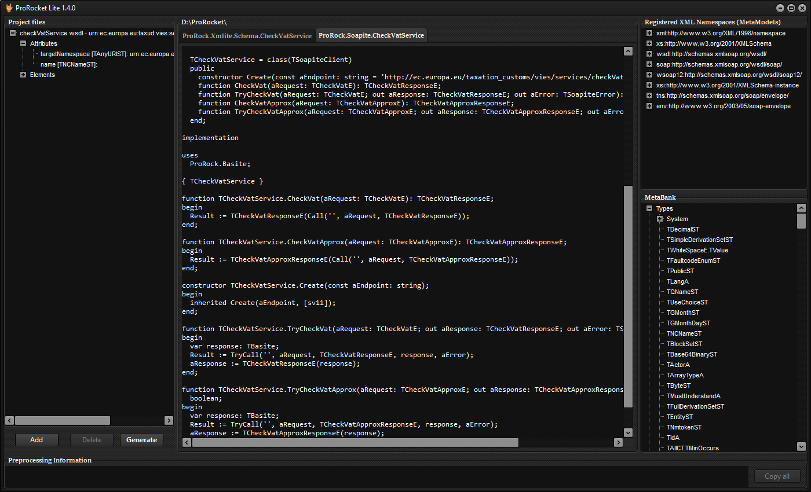

# ProRocket Lite

The code generator: XSD and WSDL in, Delphi units out.

[{ .button-icon } Download ProRocket-Lite.zip](https://github.com/VitalyPopov/ProRock/releases/latest/download/ProRocket-Lite.zip){ .md-button .md-button--primary }

Windows 64-bit, always the newest release. The SHA-256 checksum is in the
[release notes](https://github.com/VitalyPopov/ProRock/releases). The executables are not code-signed yet, so Windows
SmartScreen may warn on the first start: **More info → Run anyway**.

- free for any use, including commercial; the generated code is yours and is not covered by the ProRocket Lite license
- closed source, with its own license (`LICENSE.txt` in the zip); ProRock itself is Apache 2.0
- not needed to use ProRock: models can be written by hand as well

## What it generates

- **one unit per XML namespace**: `ProRock.Xmlite.Schema.<Name>.pas` - the types and elements of that namespace
- **one client unit per `wsdl:service`**: `ProRock.Soapite.<Service>.pas` - see [Soapite](soapite.md)
- **deterministic output**: an unchanged schema gives an unchanged unit, so a schema update shows up as a clean diff

ProRocket Lite is its own first user: it reads XSD and WSDL through ProRock, with classes it generated itself. The units for
XML Schema, WSDL and SOAP in ProRock (`ProRock.Xmlite.Schema.Base`, `.Wsdl`, `.Soap`, ...) are generated from their official
schemas and regenerated with every release - see their headers.

The unit header names the ProRock release the unit is made for ("Generated by ProRocket Lite for ProRock 1.4.0"); use that
release of the library.

## The GUI

`ProRocket.Lite.exe`: add the schema files (the main XSD or WSDL and the files it imports and includes), click **Generate**.
The project tree shows each file as ProRock reads it - parsed through ProRock's own XML Schema and WSDL classes. Generate
fills the code preview with one tab per unit and writes the units into the folder named above it.

[](assets/prorocket-lite.png)

The messages panel lists the problems found in the schema set - a missing imported schema or include, a name that resolves to
nothing. Hover a line for what it means and what to do, in plain words; **Copy all** copies the list.

## The command line

`ProRocketCli.exe` in the same zip is the same generator for scripts, build steps and AI coding assistants:

```
ProRocketCli.exe [-o <output folder>] [--strict] [--no-timestamp] <file.xsd|file.wsdl> ...
```

Problems are reported, not passed over silently: one machine-readable line each, exit code 2. Details:
[Command line](cli.md).
