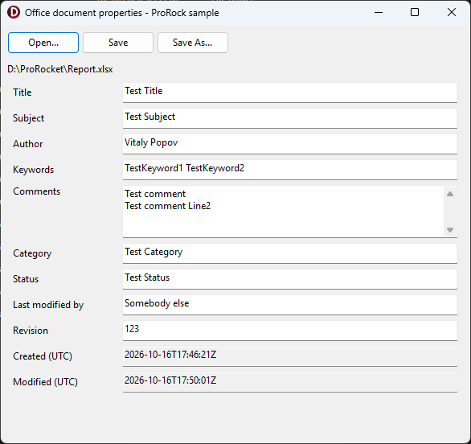

# Samples

In [`Samples`](https://github.com/VitalyPopov/ProRock/tree/main/Samples) of the repository, one group project
(`ProRock.Samples.groupproj`). The generated units and the source WSDL/XSD files are included, so the samples build without
running the generator.

| Sample | What it shows |
|---|---|
| [`ProRock.Xmlite.DocumentProperties`](#office-document-properties) | the properties of any Office document: open, edit, save |
| [`ProRock.Soapite.CheckVatService`](https://github.com/VitalyPopov/ProRock/tree/main/Samples/ProRock.Soapite.CheckVatService) | EU VIES VAT number validation through the generated `TCheckVatService`, with live SOAP Fault handling |
| [`ProRock.Soapite.WsSecurity`](https://github.com/VitalyPopov/ProRock/tree/main/Samples/ProRock.Soapite.WsSecurity) | a WS-Security UsernameToken (PasswordDigest, Nonce, Timestamp) in the SOAP header, from units generated from the OASIS schemas; offline, or `-live`. Other header blocks work the same way, e.g. the ebMS 3.0 `eb:Messaging` of AS4 |
| [`ProRock.Http.ClientCertificate`](https://github.com/VitalyPopov/ProRock/tree/main/Samples/ProRock.Http.ClientCertificate) | client certificates (mutual TLS) against the public test server client.badssl.com: HTTP 400 without, 200 with - from a file and from memory |
| [`ProRock.Soapite.Calculator`](https://github.com/VitalyPopov/ProRock/tree/main/Samples/ProRock.Soapite.Calculator) | a generated client calling a public calculator service (`-soap12` and `-xml` switches) |
| [`ProRock.Xmlite.Namespaces`](https://github.com/VitalyPopov/ProRock/tree/main/Samples/ProRock.Xmlite.Namespaces) | a generated metamodel from `order.xsd`: parsing, enums, serialization, round trip |
| [`ProRock.Xmlite.Basic`](https://github.com/VitalyPopov/ProRock/tree/main/Samples/ProRock.Xmlite.Basic) | hand-written models, basic parsing and serialization |

## Office document properties

[`ProRock.Xmlite.DocumentProperties`](https://github.com/VitalyPopov/ProRock/tree/main/Samples/ProRock.Xmlite.DocumentProperties)
opens any Office document (.docx, .xlsx, .pptx) and edits the properties Office shows in **File > Info**: title, subject,
author, keywords, description, category, status. Save writes them back; Excel opens the saved file without a repair prompt
and shows every value in File > Info.



An Office document is a zip of XML parts (OPC, ECMA-376 Part 2). The sample uses units generated from the official schemas:

- `opc-relationships.xsd` - to find the core properties part through the package relationships (`_rels/.rels`)
- `opc-coreProperties.xsd`, built on Dublin Core - the properties themselves (`docProps/core.xml`)

```pascal
// the generated classes: Dublin Core elements carry their text in XmlValue (dc:title, dcterms:created), the elements of
// the core properties namespace are plain strings (cp:category), cp:keywords is mixed content - its text is XmlText
var properties := fDocument.Properties;
TitleEdit.Text := properties.Title.XmlValue;
KeywordsEdit.Text := properties.Keywords.XmlText;
CategoryEdit.Text := properties.Category;
```

On save, `Modified` is set to now (UTC) with the `xsi:type` OPC requires, and every other part of the file is copied byte for
byte, in the same order and with the same compression:

```pascal
fProperties.Modified.XmlValue := FormatDateTime('yyyy-mm-dd"T"hh":"nn":"ss"Z"', TTimeZone.Local.ToUniversalTime(Now));
fProperties.Modified.SetXsiType(TW3cdtfCT); // <dcterms:modified xsi:type="dcterms:W3CDTF">
var core: TBytes := TEncoding.UTF8.GetBytes(TXmlite.ObjectToXml(fProperties));
```

A digitally signed document gets a warning first: the signature usually covers the core properties, so saving breaks it.

The schemas behind it use substitution groups and `xsi:type` - see [XML concepts](xml-concepts.md) for what they are.
